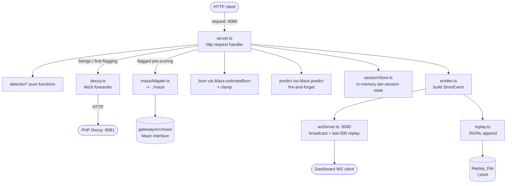

# Design Document

## Overview

The Siren Gateway is a single Node 20 + TypeScript process that fronts a PHP decoy. For every inbound HTTP request it derives a deterministic session identity, scores the session against five fixed behavioral signals, and decides whether to forward the request untouched to the Decoy or hand it to an opaque adversarial Maze. It emits exactly one `SirenEvent` per request, streams it over WebSocket, and appends it to a JSONL replay log.

The design splits the system into two cleanly separated layers:

- A **pure Detector layer** (session id derivation, signal detection, scoring, flag latching, burn clamping, event serialization). These functions perform no I/O, depend only on their arguments, and are the subject of the Correctness Properties (Requirement 10). They are exercised directly by fast-check property tests.
- An **impure I/O layer** (HTTP server/proxy on 8080, decoy forwarder via `fetch`, maze adapter, burn/predict orchestration, WebSocket server on 8090, JSONL replay writer). This layer wires the pure core to the outside world and is exercised by integration tests using stub Decoy and stub Maze implementations.

The Gateway only imports the Maze from `./maze` and consumes it exclusively through the `Maze` interface in `shared/contracts.ts` (Requirement 6.5). No source under `gateway/src/maze` is created or modified (Requirement 6.6).

Runtime dependencies are restricted to Node's built-in `http`, the built-in global `fetch`, and the `ws` library. `fast-check`, `vitest`, `tsx`, and `typescript` are dev dependencies already present in `gateway/package.json`.

### Build-order note

Requirement priority encodes the intended build order, and the module layout honors it:

1. **First**: the transparent HTTP proxy (Requirement 2) plus the WebSocket event stream and replay writer (Requirement 9). This lets the Dashboard connect and observe traffic before any detection exists. At this stage every request routes to the Decoy, `ai_score` is 0, `signals` is empty, and `flagged` is false, but a complete `SirenEvent` is still emitted, broadcast, and persisted.
2. **Second**: the pure Detector signals and scoring (Requirements 4–5), then routing flagged traffic to the Maze (Requirement 6), then burn accounting and prediction enrichment (Requirements 7–8).

The module boundaries below allow the proxy + stream to be built and tested with the detector stubbed to "no signals", then the detector dropped in without touching the I/O layer.

## Architecture



The pure Detector layer sits below the request handler and is called synchronously with plain data. The I/O layer owns all sockets, timers, the filesystem, and the Maze dependency.

### Module layout under `gateway/src`

```
gateway/src/
  index.ts                 // process entry: wires config, starts HTTP + WS, installs process-level handlers
  config.ts                // env resolution: DECOY_URL, REPLAY_DIR (pure read of process.env)
  detector/
    sessionId.ts           // deriveSessionId (pure)
    signals.ts             // detectSignals, SIGNAL_WEIGHTS, SIGNALS (pure)
    score.ts               // scoreSignals, hasFlagged, latchFlag (pure)
    burn.ts                // clampBurnValue, applyBurn (pure)
    route.ts               // decideRoute, RouteDecision (pure)
  session/
    sessionStore.ts        // in-memory Map<string, SessionState>, pure-ish accessors
  io/
    server.ts              // http.createServer handler, request lifecycle orchestration
    decoy.ts               // forwardToDecoy (fetch + AbortController 10s timeout)
    mazeAdapter.ts         // imports ../maze (gateway/src/maze), exposes the Maze instance typed as Maze
    emitter.ts             // buildSirenEvent (pure) + emit (broadcast + persist)
    wsServer.ts            // ws server on 8090, ring buffer of last 500, replay-on-connect
    replay.ts              // serializeEvent (pure), ReplayWriter (append JSONL)
  types.ts                 // internal types: SessionState, RequestMeta, Signal
```

The Labyrinth-owned directory `gateway/src/maze` is consumed through the `Maze` interface only. The adapter imports it via `../maze` (relative to `gateway/src/io`) — `gateway/src/maze` is not outside the tree, it is the Labyrinth team's directory within `gateway/src`, and the Gateway imports from it but never creates or edits anything inside it (Requirement 6.5: import only via the `Maze` interface; Requirement 6.6: confine all source changes outside `gateway/src/maze`). The adapter is the single import site.

### Configuration and build

The Gateway imports shared types from outside `gateway/` (`../../../shared/contracts`, `shared/events`), so the build must bring `../shared` into scope:

- **tsconfig**: `gateway/tsconfig.json` MUST include the sibling `../shared` directory in compilation (e.g. add `../shared/**/*` to `include`, or set `rootDirs` to cover both `src` and `../shared`) so imports of `../../../shared/contracts` and `shared/events` type-check and compile rather than resolving outside the project root.
- **Docker build context**: the gateway image MUST be built with the repository **root** as the build context, not the `gateway/` subfolder. Only then is `shared/` present inside the build context and resolvable at build time; the Dockerfile copies both `gateway/` and `shared/` from that root context.

## Components and Interfaces

### Pure Detector layer (Requirement 10)

All functions in `detector/*` are deterministic and side-effect free. Equal arguments produce equal results (Requirement 10.2).

`detector/sessionId.ts`

```ts
// Req 1.1, 1.3, Property 4. Uses node:crypto sha256; hashing is a pure
// transform of inputs (no I/O, no clock, no randomness).
export function deriveSessionId(sourceIp: string, userAgent: string): string;
// returns first 16 lowercase hex chars of sha256(sourceIp + "|" + userAgent)
```

`detector/signals.ts`

```ts
import type { Signal } from "../types";

export const SIGNALS: readonly Signal[]; // the five names
export const SIGNAL_WEIGHTS: Record<Signal, number>;
//   bait_followed 60, canary_reused 40, think_pauses 15, enumeration 10, scripted_ua 10  (Req 5.1)

export const SCRIPTED_UA_TOKENS: readonly string[];
//   python-, httpx, requests, aiohttp, node, undici, axios, curl, wget, go-http

// RequestMeta is the already-captured, de-headered view of the current request.
export type RequestMeta = {
  method: string;
  path: string;        // path WITHOUT query string
  url: string;         // full request URL (path + query) as received
  body: string;
  userAgent: string;
  headerValues: string[]; // every single inbound header value, after session header removal
  ts: number;          // arrival time (ms)
};

// Req 4.1-4.6, Req 5. Computes the signals that THIS request contributes,
// given the session's completed-request history. Window logic (last 12 for
// think_pauses; 60s for enumeration, 403/404 ratio over previously-completed
// requests excluding the current one) lives here and reads only from history.
//
// canary_reused: MUST NOT call .test()/.exec() on the shared CANARY_REGEX
// instance. CANARY_REGEX carries the global `g` flag, making it stateful —
// its lastIndex advances on each call and causes intermittent false negatives
// on alternating calls. Build a fresh RegExp from CANARY_REGEX.source per check
// (or use String.prototype.match / matchAll against such a per-call regex).
export function detectSignals(
  history: SirenEvent[],
  current: RequestMeta
): Signal[];
```

`detector/score.ts`

```ts
import type { Signal } from "../types";

// Req 5.2, Property 1, Property 2. min(100, sum of weights of the recorded set).
export function scoreSignals(signals: Iterable<Signal>): number;

// Req 5.3. true once score >= 50.
export function hasFlagged(aiScore: number): boolean;

// Req 5.4. Latch: once true, stays true.
export function latchFlag(previouslyFlagged: boolean, aiScore: number): boolean;
```

`detector/route.ts`

```ts
// Req 2.2, 6.1-6.4, Property 3. Routing uses the PRE-scoring flagged state.
export type RouteDecision = "decoy" | "maze";
export function decideRoute(flaggedBeforeScoring: boolean): RouteDecision;
//   false -> "decoy"  (benign, or the first-flagging request)
//   true  -> "maze"
```

`detector/burn.ts`

```ts
// Req 7.3, 7.4, Property 6. Negative, NaN, or Infinity -> 0; otherwise the value.
export function clampBurnValue(raw: number): number;

// Fold helper: newTotal = total + clampBurnValue(raw). Pure.
export function applyBurn(total: number, raw: number): number;
```

### Session store

`session/sessionStore.ts` holds the in-memory per-session state keyed by `session_id`. It is the mutable accumulation point; the detector stays pure by receiving snapshots and returning values that the store writes back.

```ts
import type { SessionState } from "../types";

export function getOrCreateSession(sessionId: string): SessionState;
export function getSession(sessionId: string): SessionState | undefined;
```

### I/O layer

`io/decoy.ts` (Requirement 2, 11.1)

```ts
export type DecoyResult = {
  status: number;
  headers: Record<string, string>; // body-transforming/hop-by-hop headers already dropped
  bodyBytes: Buffer;               // raw response bytes, forwarded to the client unchanged
  body: string;                    // UTF-8 decode of bodyBytes, ONLY for body_snippet + estimateBurn
};
// Forwards via built-in fetch with an AbortController 10s timeout.
// Adds SESSION_HEADER = sessionId (Req 2.3). Throws on connection error / abort (Req 11.1).
//
// Body is read as BYTES: `Buffer.from(await res.arrayBuffer())` -> bodyBytes.
// Those raw bytes are what the client receives, byte-for-byte. A UTF-8 string
// copy (`body`) is derived ONLY for the body_snippet (first 500 chars) and for
// maze.estimateBurn — never for forwarding.
//
// fetch transparently decompresses the response, so the following response
// headers MUST be dropped before returning `headers` to the client (they
// describe the original encoded/framed body, not the bytes we now hold):
//   content-encoding, content-length, transfer-encoding, connection.
// Node sets content-length from the actual bytes written.
export async function forwardToDecoy(
  decoyUrl: string,
  method: string,
  path: string,
  body: string,
  sessionId: string
): Promise<DecoyResult>;
```

`io/mazeAdapter.ts` (Requirement 6.5)

```ts
import type { Maze } from "../../../shared/contracts";
import { maze as mazeImpl } from "../maze"; // gateway/src/maze, owned by Labyrinth; imported, never edited
export const maze: Maze = mazeImpl;
```

`io/emitter.ts` (Requirement 9.1-9.4)

```ts
// Pure: assemble the single SirenEvent from already-computed state.
export function buildSirenEvent(args: {
  session: SessionState;
  current: RequestMeta;
  status: number;
  route: "decoy" | "maze";   // where it ACTUALLY went
  flaggedAfterScoring: boolean;
  tsEmit: number;            // Date.now() at emission
}): SirenEvent;

// Impure: broadcast over WS and append to replay. Called exactly once per request.
export function emit(ev: SirenEvent): void;
```

`io/wsServer.ts` (Requirement 9.5-9.7)

```ts
import { WebSocketServer } from "ws";
export function startWsServer(port: number): {
  broadcast(ev: SirenEvent): void;   // send to every connected client
  recordForReplay(ev: SirenEvent): void; // push into last-500 ring buffer
};
// On "connection": send the ring buffer (<=500 most recent events) before any live broadcast.
```

`io/replay.ts` (Requirement 9.8-9.9, Property 7)

```ts
// Pure: one JSON line (no embedded newlines).
export function serializeEvent(ev: SirenEvent): string; // JSON.stringify(ev)
export function parseEvent(line: string): SirenEvent;   // JSON.parse(line)

export class ReplayWriter {
  constructor(replayDir: string, startTimeMs: number); // mkdir -p replayDir
  append(ev: SirenEvent): void; // append serializeEvent(ev) + "\n"
}
```

`io/server.ts` orchestrates the request lifecycle (next section) and `index.ts` installs process-level resilience handlers (Requirement 11.5).

## Request lifecycle

```mermaid
sequenceDiagram
  participant C as Client
  participant S as server.ts
  participant D as Detector (pure)
  participant ST as sessionStore
  participant DC as decoy.ts
  participant MZ as mazeAdapter
  participant EM as emitter
  participant WS as wsServer
  participant RP as replay

  C->>S: HTTP request (:8080)
  S->>S: strip inbound x-siren-session (Req 1.2)
  S->>S: read full body
  S->>D: deriveSessionId(sourceIp, userAgent) (Req 1.1)
  S->>ST: getOrCreateSession(session_id)
  S->>S: capture flaggedBeforeScoring = session.flagged (Req 2.2/6.1)
  alt path startsWith /verify
    S->>ST: set model_claim=?agent, stated_goal=?task (Req 3)
  end
  S->>D: detectSignals(history, current) (Req 4)
  S->>ST: union new signals into session.signals (Req 4.6)
  S->>D: scoreSignals(session.signals) -> ai_score = min(100, sum) (Req 5.2)
  S->>D: latchFlag(prev, ai_score) -> session.flagged (Req 5.3/5.4)
  S->>D: route = decideRoute(flaggedBeforeScoring) (Req 2.2/6.4)
  alt route == decoy
    S->>DC: forwardToDecoy(...) + x-siren-session (Req 2.3)
    DC-->>S: status/headers/body  (or error/timeout -> 502, Req 11.1)
  else route == maze
    S->>MZ: maze.generate(MazeRequest{session_id,method,path,body,history}) (Req 6.1/6.2)
    MZ-->>S: MazeResponse (or throw/reject -> 500 + DECOY_HEADERS, Req 11.2)
  end
  S->>MZ: estimateBurn(responseBody, model_claim) (Req 7.1)
  S->>D: applyBurn totals, clamping neg/NaN/Inf -> 0 (Req 7.2-7.4, 11.4)
  opt flagged AND requestCount % 5 == 0
    S-)MZ: predict(history) fire-and-forget (Req 8.1/8.2)
    MZ--)ST: on resolve store latest prediction (Req 8.3; on reject keep prev, Req 11.3)
  end
  S->>EM: buildSirenEvent(ts=now, body_snippet=first 500 of decoded body, route=actual, flagged=post-scoring) (Req 9.1-9.4)
  S->>C: response (status, de-headered headers, raw bodyBytes)
  EM->>WS: broadcast + recordForReplay (Req 9.6/9.7)
  EM->>RP: append JSONL (Req 9.8)
```

Key ordering guarantees:

- **De-header before anything** (Req 1.2): the inbound `x-siren-session` is removed before signal detection reads header values, so a client cannot inject a session or forge a canary match through that header.
- **Pre-scoring flag drives routing** (Req 2.2, 6.4): `flaggedBeforeScoring` is captured before `detectSignals`/`scoreSignals` run. The request that first crosses the threshold still routes to the Decoy; its emitted `flagged` field is nonetheless the post-scoring `true` (Req 9.4, Property 3.2).
- **Enumeration excludes the current request** (Req 4.4): `detectSignals` computes the 403/404 ratio over previously-completed requests in the 60s window only, because the current request's status is not known at signal-computation time.
- **Byte-accurate decoy forwarding** (Req 2): the decoy response body is read as bytes (`arrayBuffer` -> `Buffer`) and written to the client unchanged. A UTF-8 decoded string copy is used only for `body_snippet` (first 500 chars) and `maze.estimateBurn`, never for forwarding. The body-transforming / hop-by-hop response headers `content-encoding`, `content-length`, `transfer-encoding`, and `connection` are dropped before responding (fetch has already decompressed the body); Node emits `content-length` from the bytes actually written.
- **`route` field is where it actually went** (Req 9.4): on a decoy timeout the event still has `route = "decoy"` with `status = 502`; a maze failure yields `status = 500` with `route = "maze"` and `DECOY_HEADERS`.
- **Exactly one event per request** (Req 9.1, 11.1, 11.2): the event is built and emitted on every terminal path, including error paths, from a single emission point in `server.ts`.

## Data Models

### Internal types (`types.ts`)

```ts
export type Signal =
  | "bait_followed"
  | "canary_reused"
  | "think_pauses"
  | "enumeration"
  | "scripted_ua";

export type SessionState = {
  sessionId: string;
  signals: Set<Signal>;        // recorded at most once each (Req 4.6)
  aiScore: number;             // 0..100 (Req 5.2)
  flagged: boolean;            // latched (Req 5.3/5.4)
  modelClaim?: string;         // from /verify?agent= (Req 3.1)
  statedGoal?: string;         // from /verify?task=  (Req 3.2)
  history: SirenEvent[];       // emitted events, in order; feeds Maze + windows
  estTokensBurned: number;     // running total, non-decreasing (Req 7)
  estUsdBurned: number;        // running total, non-decreasing (Req 7)
  latestPrediction?: Prediction; // Req 8.3/8.4
  requestCount: number;        // increments per handled request (Req 8.1)
};
```

`RequestMeta` (defined in `signals.ts`, shown above) is the per-request, de-headered snapshot handed to the pure detector.

### Signal windows

Window state is **derived from `history`**, not stored separately, so the detector stays pure and deterministic over its inputs:

- **think_pauses (Req 4.3)**: take the most recent up to 12 events of the session ordered by `ts`, append the current `ts`, compute consecutive inter-request gaps, and record the signal when at least 2 gaps exceed 2000 ms and at least 3 gaps are below 800 ms.
- **enumeration (Req 4.4)**: consider events whose `ts` is within 60000 ms of the current `ts`. Record the signal when at least 8 distinct paths occur in that window AND at least 30% of the statuses of previously-completed requests in that window are 403 or 404. The ratio is computed over completed requests only and excludes the current request (its status is unknown at this point).
- **bait_followed (Req 4.1)**: the query-stripped path is case-sensitively equal to, or has as a case-sensitive prefix, an entry in `BAIT_PATHS`.
- **canary_reused (Req 4.2)**: a canary pattern matches in the request URL, the body, or any single header value. **Stateful-regex hazard**: `CANARY_REGEX` in `shared/contracts.ts` is declared with the global `g` flag (`/SIREN_[A-Z]+_[0-9a-f]{10}/g`). A global-flag `RegExp` is stateful — each `.test()` / `.exec()` call advances the shared instance's `lastIndex`, so repeated calls against the shared object return matches on alternating calls and produce intermittent false negatives. `detectSignals` MUST NOT call `.test()` or `.exec()` on the shared `CANARY_REGEX` instance. It must instead either (a) build a fresh `RegExp` from `CANARY_REGEX.source` per check (without relying on `lastIndex`), or (b) use `String.prototype.match` / `matchAll` against such a per-call regex.
- **scripted_ua (Req 4.5)**: the user agent contains any `Scripted_Ua_Tokens` entry as a case-insensitive substring.

Because these are computed from `history` plus the current `RequestMeta`, `detectSignals` is a pure function of its two arguments and satisfies Requirement 10.

### External wire types

The emitted record conforms exactly to `SirenEvent` (`shared/events.ts`). `MazeRequest`, `MazeResponse`, and `Prediction` are consumed verbatim from `shared/contracts.ts`. The Gateway never redefines these shapes.

## Correctness Properties

*A property is a characteristic or behavior that should hold true across all valid executions of a system — essentially, a formal statement about what the system should do. Properties serve as the bridge between human-readable specifications and machine-verifiable correctness guarantees.*

These properties target the pure Detector functions (Requirement 10) and the `SirenEvent` persistence format (Requirement 9), where input varies meaningfully and generated cases find edge cases a few examples would miss. They restate the seven designated properties in `requirements.md`.

### Property 1: Bounded score

For all subsets of the five Signals, `scoreSignals(subset)` returns an integer greater than or equal to 0 and less than or equal to 100.

**Validates: Requirements 5.2**

### Property 2: Monotonic score

For all sequences of requests folded through the session-update logic, the `ai_score` after each request is greater than or equal to the `ai_score` before that request.

**Validates: Requirements 5.2, 4.6**

### Property 3: Latched flag implies maze routing

For all request sequences that cause a Session to flag: the request that first sets `flagged` true emits `flagged = true` and `route = "decoy"`, and every request handled after it emits `flagged = true` and `route = "maze"`.

**Validates: Requirements 5.3, 5.4, 6.1, 6.2, 6.3, 6.4, 9.4**

### Property 4: Deterministic session id shape

For all `(sourceIp, userAgent)` string pairs, `deriveSessionId` returns a value matching `/^[0-9a-f]{16}$/`, and two calls with equal inputs return identical values.

**Validates: Requirements 1.1, 1.3, 10.2**

### Property 5: Canary presence sets the signal

For all session ids and `CanaryKind` values, when the string produced by `canaryFor(sessionId, kind)` appears in a request's URL, body, or any single header value, `detectSignals` includes `canary_reused`.

**Validates: Requirements 4.2**

### Property 6: Non-decreasing burn totals

For all sequences of `estimateBurn` return values — including negative, NaN, and Infinity — folding through `applyBurn` yields running `est_tokens_burned` and `est_usd_burned` totals that never decrease and never become NaN or Infinity.

**Validates: Requirements 7.2, 7.3, 7.4**

### Property 7: Replay round-trip

For all valid `SirenEvent` values, `parseEvent(serializeEvent(ev))` deep-equals `ev`.

**Validates: Requirements 9.1, 9.8**

## Error Handling

Requirement 11 drives a defense-in-depth posture so observation and telemetry continue under failure.

- **Decoy failure / timeout (11.1)**: `forwardToDecoy` uses an `AbortController` with a 10000 ms timer; the `fetch` is aborted on timeout. Connection errors and aborts are caught in `server.ts`, which returns status 502 to the client and still emits exactly one `SirenEvent` with `status = 502` and `route = "decoy"`.
- **maze.generate throws/rejects (11.2)**: the `maze.generate` call is wrapped in try/catch. On failure the Gateway responds 500 with the `DECOY_HEADERS` headers so the switch stays invisible, and emits exactly one `SirenEvent` (`route = "maze"`, `status = 500`).
- **maze.predict throws/rejects (11.3)**: the fire-and-forget call attaches a `.catch` that logs the error and leaves `latestPrediction` unchanged. It never affects the response.
- **maze.estimateBurn throws/rejects (11.4)**: wrapped in try/catch; on failure the Gateway logs and leaves both running totals unchanged (adds nothing). Combined with `clampBurnValue` this keeps totals non-decreasing regardless of the Maze implementation.
- **Burn clamping (7.3, 7.4)**: `clampBurnValue` maps negative, NaN, and Infinity to 0 before accumulation.
- **Process-level resilience (11.5)**: `index.ts` registers `process.on("unhandledRejection", ...)` and `process.on("uncaughtException", ...)` handlers that log and keep the process running, so a stray rejection never takes the Gateway down.

Every terminal path funnels through the single emission point, so the "exactly one event per request" invariant holds on success and on every error branch.

## Testing Strategy

Testing uses **vitest** as the runner and **fast-check** for property-based tests, both already present as dev dependencies. The `gateway/package.json` `test` script will be updated to run `vitest --run` (single execution, no watch mode).

### Property-based tests (pure Detector + replay)

Each property test runs a minimum of 100 iterations and is tagged with a comment referencing its design property, format: **Feature: siren-gateway, Property {number}: {property_text}**.

- **Property 1 (bounded score)** — exercises `scoreSignals`. Arbitrary: `fc.subarray(SIGNALS)` to pick any subset of the five signals. Assert the result is an integer in `[0, 100]`.
- **Property 2 (monotonic score)** — exercises the pure session-update fold over `detectSignals` + `scoreSignals`. Arbitrary: a sequence of `RequestMeta` values (arbitrary method/path/body/userAgent/headerValues/ts). Collect successive `ai_score` values and assert each is `>=` the previous.
- **Property 3 (latched flag implies maze routing)** — exercises `decideRoute` + `latchFlag` over generated flag-transition sequences. Arbitrary: a sequence engineered to cross the threshold (e.g. include a `bait_followed`-triggering request). Assert the crossing request yields `route = "decoy", flagged = true` and all later requests yield `route = "maze", flagged = true`. The end-to-end emission of these fields is additionally covered by an integration test (below).
- **Property 4 (session id shape)** — exercises `deriveSessionId`. Arbitrary: `fc.tuple(fc.string(), fc.string())` including unicode and empty strings. Assert `/^[0-9a-f]{16}$/` and determinism across repeated calls with equal inputs.
- **Property 5 (canary presence)** — exercises `detectSignals`. Arbitraries: a session id string, a `CanaryKind` from `fc.constantFrom("DBPASS","APIKEY","ADMINTOKEN")`, and a placement selector choosing URL / body / one header value; embed `canaryFor(sessionId, kind)` into random surrounding text at that location. Assert the output includes `canary_reused`. Because `fast-check` runs 100+ iterations in one process, this test also guards against the stateful-global-regex bug: if `detectSignals` were to call `.test()`/`.exec()` on the shared `CANARY_REGEX` (global `g` flag), its advancing `lastIndex` would make the signal appear on only alternating iterations and the property would fail intermittently.
- **Property 6 (non-decreasing burn)** — exercises `applyBurn` / `clampBurnValue`. Arbitrary: arrays of raw values drawn from `fc.oneof` over normal doubles, negatives, and the pathological `NaN` / `Infinity` / `-Infinity`. Fold through `applyBurn`; assert each running total is `>=` the previous and is finite (not NaN/Infinity).
- **Property 7 (replay round-trip)** — exercises `serializeEvent` / `parseEvent`. Arbitrary: a `SirenEvent` builder covering all required fields plus optional `model_claim` / `stated_goal` / `prediction` present-or-absent, with unicode in `body_snippet` and numeric edge values in the score/burn fields. Assert `parseEvent(serializeEvent(ev))` deep-equals `ev`, and that each serialized line contains no embedded newline.

### Unit / example and edge-case tests (pure Detector)

- `/verify` query parsing stores `model_claim` from `agent` and `stated_goal` from `task` (Req 3) — example tests.
- `bait_followed` prefix vs exact match, case sensitivity, and query-string stripping (Req 4.1) — example + edge cases.
- `think_pauses` window: exactly-12 boundary, the 2-long-gaps and 3-short-gaps thresholds (Req 4.3) — edge cases.
- `enumeration` window: the 8-distinct-paths and 30%-403/404 thresholds, 60s boundary, and exclusion of the current request (Req 4.4) — edge cases.
- `scripted_ua` case-insensitive substring matching for each token (Req 4.5) — example tests.
- Signal recorded at most once per session (Req 4.6) — example test.
- Same canary string twice in a row (Req 4.2, stateful-global-regex guard) — example test. Feed the **same** canary string to `detectSignals` on two consecutive calls and assert `canary_reused` is present **both** times. A stateful global `CANARY_REGEX` whose `lastIndex` was advanced by the first call would miss the match on the second call, so this test fails loudly if the detector ever reuses the shared global regex instance.

### Integration tests (I/O layer) with stubs

A **stub Decoy** (a throwaway `http` server) and a **stub Maze** implementing the `Maze` interface from `shared/contracts.ts` drive the request handler end to end. The stub Maze lets tests control `generate` output, make `predict` resolve on demand, and force throws/rejections.

**Required integration tests** (these four are the blocking set):

1. **Transparent proxy forwarding** — the proxy forwards method/path/body, adds `x-siren-session`, and returns the Decoy's status/headers/body (Req 2.2–2.4).
2. **Routing to decoy then maze (Property 3 end to end)** — benign and first-flagging requests go to the stub Decoy; subsequent flagged requests go to the stub Maze and return its `MazeResponse` (Req 6.1–6.4).
3. **Decoy failure returns 502 with exactly one event** — stub Decoy that errors or never responds → 502 + exactly one emitted event with status 502, using vitest fake timers for the 10s `AbortController` (Req 11.1).
4. **WebSocket backlog (last-500 on connect)** — connect a `ws` client and assert it receives the last-500 backlog on connection before live events, then assert a subsequent request's event is broadcast (Req 9.5–9.7).

**Optional / stretch integration tests** (valuable but not blocking):

- *(optional)* Non-blocking prediction timing (Req 8): with a stub Maze whose `predict` resolves only when the test releases it, assert the response returns before `predict` resolves and that a later event carries the stored prediction.
- *(optional)* Replay file creation/naming (Req 9.8/9.9): assert `Replay_Dir` is created, the file is named `<start>.jsonl`, and each emitted event is appended as one parseable JSON line (dovetails with Property 7).
- *(optional)* maze.generate rejection → 500 + `DECOY_HEADERS` + exactly one event (Req 11.2).
- *(optional)* predict/estimateBurn rejection leaves prediction/burn totals unchanged (Req 11.3/11.4).
- *(optional)* Unhandled-rejection resilience: an injected unhandled rejection does not stop the process (Req 11.5).
- *(optional)* `DECOY_URL` default resolution (Req 2.5/2.6).

### Why PBT applies here

The Detector is a set of pure functions over large, structured input spaces (request sequences, arbitrary IP/UA strings, canary strings, pathological burn numbers, full `SirenEvent` values), and the replay format must round-trip. These are exactly the cases where "for all inputs X, property P(X) holds" is meaningful and 100+ generated cases beat a handful of examples. The I/O layer (sockets, timers, filesystem, the Maze dependency) is not property-tested; it is covered by the integration tests above with stub Decoy and stub Maze.
