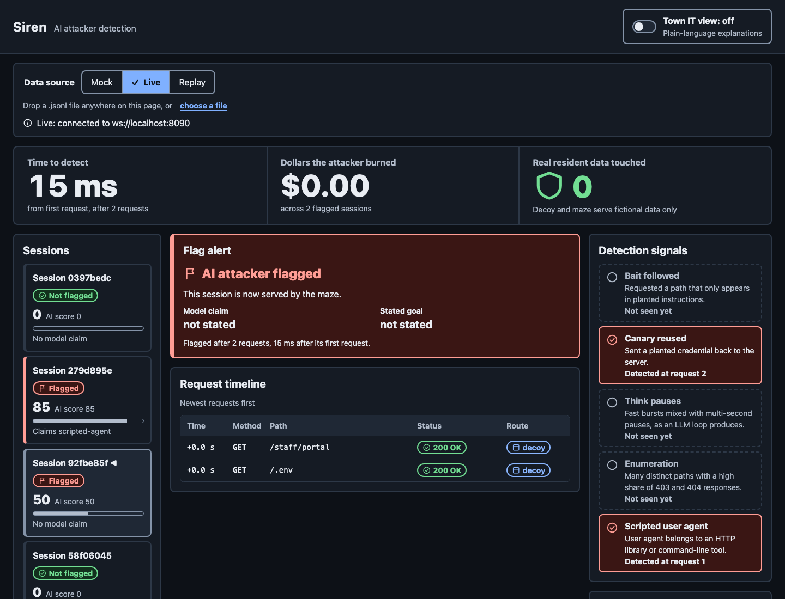
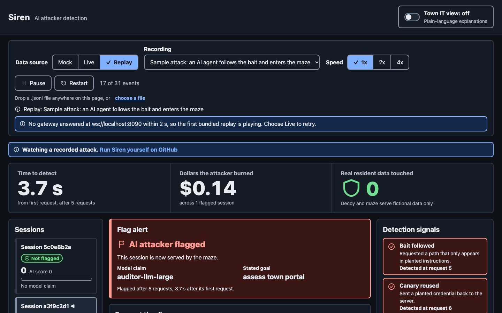
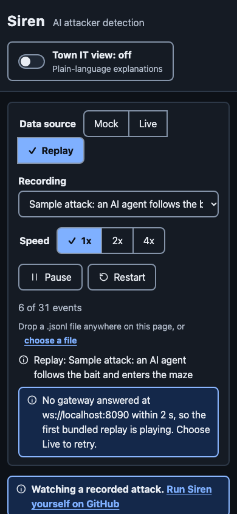

# How we built Maelstrom with Kiro

Four people built Maelstrom in one day, one role each: Bait (decoy), Brain (gateway and
detector), Labyrinth (maze and attacker) and Stage (dashboard, docs, submission). Each role kept
a Kiro log in `docs/kiro-log/`. Every claim below cites one of those logs, a file, or a commit.

Internal identifiers keep their original names on purpose: `SirenEvent`, the `SIREN_` canary
prefix, `SIREN_LLM` and the `x-siren-session` header are the frozen cross-module contract
(`.kiro/steering/maze.md`, first rule).

---

## 1. Kiro tools used, and how they differed

**Kiro IDE** was everyone's main surface.

- *Spec mode:* Brain built the gateway from a full spec (`.kiro/specs/siren-gateway/`). Stage built
  the dashboard from a feature spec (`docs/kiro-log/stage.md`, "Dashboard spec (Prompt A)").
- *Chat (vibe) mode with Autopilot:* used for small, bounded jobs, such as Stage's hosted demo,
  integration check and pre-submission risk pass, and Bait's build-fix review
  (`docs/kiro-log/bait.md`, Session 3).

**Kiro CLI.** Labyrinth built the attacker agent in the terminal. The log entry reads "Feature
used: Kiro CLI (iterate in terminal)" (`docs/kiro-log/labyrinth.md`, "Attacker agent").

**Kiro Web (cloud agent).** Brain ran GitHub issue #3 (a replay validator) as an autonomous cloud
session while continuing local work.

- *Result:* PR #4, which touched "exactly the 2 files the issue allowed". Its sandbox blocked npm,
  so Brain verified the result locally (`docs/kiro-log/brain.md`, "Kiro Web (cloud agent)";
  commit `139fd17`, authored by "Kiro Agent").
- *How it differed from the IDE:* Brain's comparison was "zero setup on my machine and fully
  parallel, but the issue had to be self-contained and scoped by file."

**Kiro Crew:** TODO: no evidence yet

---

## 2. How we structured specs, and spec-driven vs. vibe coding

**Spec layout.** Specs live in `.kiro/specs/`, one folder per module, with requirements in EARS form:

| Spec | Owner | Files |
| --- | --- | --- |
| `siren-gateway/` | Brain | requirements, design, tasks (+ `tasks.meta.json`) |
| `decoy/` | Bait | requirements (20 numbered requirements), tasks |
| `maze/` | Labyrinth | requirements, design, tasks |
| `decoy-request-header-forwarding/` | Brain | a **Bug Fix spec**: `bugfix.md`, design, tasks |

The maze requirements end with a table that maps each requirement to the property suite that
tests it (`.kiro/specs/maze/requirements.md`, "Correctness property mapping").

**Where the spec review gates caught bugs before any code existed.**

- *Requirements review:* Brain found 4 gaps. One was that the flagging request would have been
  routed to the maze, so the decoy's `/verify` page would never be served. Brain's verdict: "these
  would have surfaced as integration bugs at 3 PM. The spec's review gate caught them in 5
  minutes." (`docs/kiro-log/brain.md`, "Requirements review").
- *Design review:* caught a stateful global-regex bug. `CANARY_REGEX` has the `/g` flag, so reusing
  it with `.test()` would have missed canary reuse on alternating checks (`brain.md`, "Design review").
- *Bait's spec:* writing it "caught two I'd otherwise have missed (REQ-D-11 HTML comment, REQ-D-15
  session fallback)" (`bait.md`, Session 2).

**The spec kept the work honest.**

- Kiro's task runner "refused untracked work", so a new scripted-attacker test became spec task
  4.12 instead of being slipped in (`brain.md`, "Property-based testing caught an overflow bug").
- The Bug Fix spec traced a header-forwarding bug back to Requirement 2.2 and a steering line that
  had caused it, then fixed the requirement, the steering and the code together (`brain.md`,
  "Bugfix spec: decoy request headers"; commit `638fc2a`).

**Where vibe coding fit better.**

- Stage used chat mode for the hosted-demo work because "it's a small, well-bounded change, so a chat
  session fit better than a spec" (`stage.md`, "Hosted demo (Prompt C)").
- Stage's summary of the spec run: it was "much faster for the first 90%", while "the last 10%
  (layout tuning, dead code, the real verification) was still hands-on" (`stage.md`, "Dashboard
  spec").

---

## 3. Each hook, and what it automated

All three hooks are v1 `PostFileSave` command hooks. A command hook runs a shell command and makes
no LLM call. Bait chose this on purpose so that a hook "runs in milliseconds with zero LLM calls"
(`bait.md`, Session 1).

| Hook file | Matcher | What it runs | Owner |
| --- | --- | --- | --- |
| `.kiro/hooks/bait-safety-lint.json` | `decoy/` | `bash decoy/scripts/safety-lint.sh` | Bait |
| `.kiro/hooks/brain-contract-guard.json` | `(^\|/)shared/.*\.ts$` | `tsc --noEmit` in `gateway/` (and `dashboard/` if installed) | Brain |
| `.kiro/hooks/maze-property-tests.json` | `gateway[\\/]src[\\/]maze[\\/].*\.(ts\|json)$` | the maze property tests in mock mode, dot reporter | Labyrinth |

- **bait-safety-lint** fails the save if a PHP file calls a dangerous function, a credential lacks the
  `SIREN_` prefix, or a real secret format appears. Bait negative-tested it: it caught a `system()`
  call and a fake AWS-style key, exited 1, then passed once both were removed (`bait.md`, Session 2).
- **brain-contract-guard** type-checks the gateway and dashboard whenever a shared contract file
  changes, "so a schema change can't silently break another module" (the hook's `description`;
  commit `83d8283`). Bait fixed `gateway/tsconfig.json` so `tsc --noEmit` passed, which "unblocks
  Brain's contract-guard hook" (`bait.md`, Session 2).
- **maze-property-tests** re-runs every maze property on save and shows the shrunk failing example
  when one breaks.

**An on-demand workflow without a hook.** Kiro IDE 1.x hooks have no manual trigger. Following the
Kiro docs, Stage made `/stage-docs-sync` a manually included steering file instead (`stage.md`,
"Pre-submission risk pass"; commit `9149895`). That file defines how this document is written.

---

## 4. Our steering strategy

Steering lives in `.kiro/steering/` and comes in three inclusion types.

**Global files, always included.**

- `structure.md` maps folders to owners and sets the rule "only create or edit files in the folders
  your role owns."
- `product.md` and `tech.md` exist but are empty on `main`.

**Per-module `fileMatch` files.** Each loads only when Kiro touches that module's files:

| File | `fileMatchPattern` |
| --- | --- |
| `dashboard.md` | `dashboard/**` |
| `decoy.md` | `decoy/**` |
| `gateway.md` | `gateway/src/**` |
| `maze.md` | `{gateway/src/maze/**,attacker/**}` |

Bait's verdict: "The steering scoping feature saved real time — without it, every request would have
needed the full contract pasted in" (`bait.md`, Session 1). Stage's spec run followed the steering
rules: a type-only `SirenEvent` import, no new event fields, colors only through CSS variables
(`stage.md`, "Dashboard spec").

**Manual files.** `stage-docs-sync.md` (`inclusion: manual`) runs as the `/stage-docs-sync` slash
command.

**Steering can carry a bug, too.** One steering line ("the decoy gets only the x-siren-session header
added") reinforced a requirement that dropped the client's headers. The Bug Fix spec corrected both
(`brain.md`, "Bugfix spec: decoy request headers").

---

## 5. MCP servers and what they enabled

TODO: no evidence yet

---

## 6. What property-based testing caught

We used fast-check in both the gateway and the maze. Each property below names the input it failed
on and the fix.

- **Brain, Property 6 (burn totals never decrease and stay finite).**
  - *What failed:* it failed in 3 of 7 runs. The shrunk counterexample was two finite, non-negative
    values whose sum overflowed past `Number.MAX_VALUE`, so the total became `Infinity`.
  - *Fix:* saturate the total at `Number.MAX_VALUE`, and add Requirement 7.5 so the spec covers
    overflow (`brain.md`, "Property-based testing caught an overflow bug"; commit `439d1d1`).
- **Brain, Property 7 (replay round-trip).**
  - *What failed:* shrinking 26 times reduced the failure to a minimal event. That showed it was a
    test bug, not a product bug: fast-check 4 can build null-prototype objects, and `JSON.parse`
    never does.
  - *Fix:* `noNullPrototype: true` in the generator. The strict comparison stayed
    (`brain.md`, "Property 7 failure was a test bug").
- **Labyrinth, sanitizer property ("sanitize never leaks a real-secret pattern, for any input").**
  - *What failed:* it forced a fresh regex per call, because a shared `/g` regex's `lastIndex` would
    otherwise skip matches across inputs (`labyrinth.md`, "Property-based testing (showcase)").
- **Labyrinth, XSS-safety property.**
  - *What it caught:* the maze reflected the attacker-chosen path into HTML unescaped.
  - *Fix:* `escapeHtml()` in `sanitize.ts`. The property feeds fuzzed `<script>` and attribute-breakout
    payloads and checks that no raw breakout character survives (`labyrinth.md`, "Hardening pass";
    commit `6b4b663`).
- **Labyrinth, anti-escape property.** Guards that no 200-page link is ever shallower than the
  request, so a flagged session cannot climb out of the maze (same entry).

**Current coverage.** The maze suite has 18 property tests, mapped to requirements R2–R13 in
`.kiro/specs/maze/requirements.md`. The full gateway suite passes 47/47 in mock mode.

---

## 7. Which Powers we used or built

**Built: `powers/siren/`** (Bait, commits `f858029` and `e6bf662`).

- *Layout:* follows the documented Power layout, a `POWER.md` with YAML front-matter plus
  `steering/`, `hooks/` and `examples/`.
- *How Bait matched the format:* by checking the kiro.dev Powers docs and two reference Power repos
  (`bait.md`, Session 2).

What the Power ships:

- `steering/safety.md`: the decoy safety rules (canary-only credentials, no exploitable code,
  fictional content).
- `steering/gateway-integration.md`: how to put the detection gateway in front of an existing app.
- `hooks/bait-safety-lint.kiro.hook`: the safety-lint hook, packaged for reuse.
- `examples/safety-lint.sh`: the lint script.

The Power's onboarding steps cover copying the steering, installing the hook, the `SIREN_` canary
format, and wiring the gateway (`powers/siren/POWER.md`, "Onboarding").

**Used from others:** TODO: no evidence yet

---

## Screenshots

